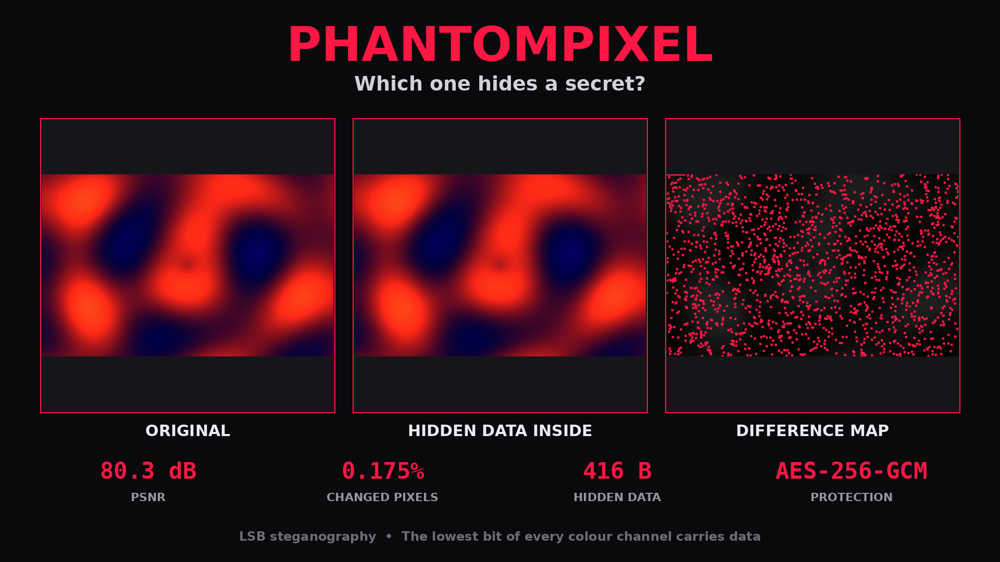

<div align="center">

# PHANTOMPIXEL

**Hide data inside images. Invisible to the eye.**
An LSB steganography studio: hide, extract, inspect, and generate shareable comparison cards.




*The two images on the left are indistinguishable. The map on the right shows how the hidden data is scattered across the picture.*

</div>

---

## Features

- **Hide text or any file** (PDF, ZIP, photo...) inside an image. Capacity depends on the image size; text and documents are **compressed** automatically, so they fit more.
- **One-question flow:** type a message, or just press Enter to pick a file with a normal file dialog.
- **Back at every step:** type `<` at any prompt to go back; on the first step it returns to the menu.
- **Drag & drop smart mode:** drop an image onto the program. It extracts if the image holds hidden data, otherwise it starts hiding.
- **Password protection:** AES-256-GCM with a key derived by `scrypt`. The pixels that carry the data are chosen by a password-keyed permutation.
- **Reliable by design:** integrity check (CRC-32), automatic read-back verification after every write, refuses to overwrite your original image, atomic file writes.
- **Inspector:** exact signature check, a statistical chi-square detector, PSNR, and an LSB-plane view.
- **Share card:** a 1920x1080 image showing *original | hidden | difference map*.
- **Quick demo:** one key shows the whole pipeline. No files needed.
- **Start-up animation:** noise pixels resolve into the banner, just like a hidden message resolves out of a picture (`--no-anim` skips it).
- **3 languages:** English, Türkçe, Русский. Switch from the menu (key `7`) or with `--lang`; the choice is remembered.
- **Scripting:** `--json` output for `hide`, `extract`, `inspect` and `capacity`.
- **Version-safe format:** new versions open images made by old versions, never the other way round (see [Compatibility](#compatibility-between-versions)).
- **Runs without Python:** build a single-file `.exe` (or download it from Releases).

## Quick start

### A) Windows EXE (no Python needed)

1. Download `PhantomPixel.exe` from the [Releases](../../releases) page, **or** double-click `build_exe.bat` to build it yourself (`dist\PhantomPixel.exe`).
2. Copy it to a USB stick and double-click it on any Windows PC.
3. Press `1` then Enter for the demo, or drag an image onto the `.exe`.

> The EXE is unsigned, so Windows SmartScreen or an antivirus may warn you. Choose "Run anyway".
> This happens with every unsigned PyInstaller program.

### B) From source

```bash
pip install -r requirements.txt
python main.py
```

On Windows you can simply double-click `run.bat`.

## Using the menu

| Key | Action   | What it does                                                    |
|-----|----------|-----------------------------------------------------------------|
| 1   | Demo     | Hides, extracts and shows the comparison card with one key      |
| 2   | Hide     | Cover image → secret (text or file) → password (optional) → go  |
| 3   | Extract  | Image → password (if needed) → message or file                  |
| 4   | Inspect  | Signature check, statistical test, comparison with the original |
| 5   | Card     | Builds the shareable comparison image                           |
| 6   | Capacity | How much data fits into an image                                |
| 7   | Language | English · Türkçe · Русский (remembered for next time)           |

At every prompt: **drop a file** onto the window, **paste a path**, or **press Enter** to open the file dialog.
Type **`<`** to go back one step.

Results are saved **next to the image you chose** (`photo.png` → `photo_phantom.png`), and the program can open the folder for you.

## Command line

```bash
python main.py                                  # interactive menu
python main.py photo.png                        # smart mode (same as drag & drop)
python main.py demo
python main.py hide cover.png -m "secret text" --card
python main.py hide cover.png -f report.pdf -p  # -p asks for a password (hidden input)
python main.py extract cover_phantom.png -p
python main.py inspect cover_phantom.png --original cover.png
python main.py capacity cover.png               # how much fits?
python main.py card cover.png cover_phantom.png
```

Options that work with every command:

| Option        | Meaning                                                                       |
|---------------|-------------------------------------------------------------------------------|
| `--lang xx`   | `en`, `tr` or `ru`. Beats `PHANTOMPIXEL_LANG`, the saved choice and the system language |
| `--no-anim`   | Skip the start-up animation (also: `PHANTOMPIXEL_NO_ANIM=1`; it is skipped automatically when the output is not a terminal) |
| `--json`      | `hide`, `extract`, `inspect`, `capacity`: print exactly one JSON object on stdout |

### JSON output for scripts

```bash
python main.py capacity cover.png --json
# {"ok": true, "width": 1280, "height": 800, "capacity_bytes": 383961, "capacity_bytes_with_password": 383933}

PHANTOMPIXEL_PASSWORD=secret python main.py hide cover.png -m "hi" -p --json
python main.py extract cover_phantom.png --json     # on error: {"ok": false, "error": "...", "code": "WrongPasswordError"}, exit status 1
```

`code` is the exception name and never changes with the language; `error` is the text in the chosen language.
For `-p` in scripts the password can come from the `PHANTOMPIXEL_PASSWORD` environment variable (no prompt, so nothing to type).

## How it works

Every pixel has three colour channels (R, G, B), each a number from 0 to 255. Changing the
**least significant bit** (LSB) of a channel moves its value by at most 1, which is invisible:

```
channel value:     1 1 0 0 1 0 0 [1]   = 201
                                ^ lowest bit = 1 bit of hidden data
hidden bit is 0:   1 1 0 0 1 0 0 [0]   = 200   (difference: 1/255)
```

With a password two more things happen:

1. The data is encrypted with **AES-256-GCM**.
2. The pixels that hold the bits are chosen by a **keyed permutation**, so the data is spread over the whole
   image instead of sitting in one block. Without a password the permutation is keyed by the public salt,
   which still avoids a visible stripe at the top of the image.

### File format (PPX3, since v2.1)

A 29-byte header is written sequentially into the first bits, the body is scattered over the rest:

| Field  | Size  | Meaning                                                                    |
|--------|-------|----------------------------------------------------------------------------|
| MAGIC  | 4 B   | `PPX3` (v2.0 wrote `PPX2`)                                                 |
| FLAGS  | 1 B   | bit 0: password-protected, bit 1: zlib-compressed                          |
| SALT   | 16 B  | random per file (scrypt salt / scatter seed)                               |
| LENGTH | 4 B   | body length                                                                |
| CRC32  | 4 B   | integrity check of the body                                                |
| BODY   | ...   | `[nonce 12B] + data + [tag 16B]` (password) or plain data; data is compressed when that helps |

What is new in PPX3:

- **Compression:** the secret is compressed with zlib before it is encrypted, but only when that really makes it smaller.
  Decompression is limited to 512 MB, so a tiny hostile image cannot expand into gigabytes.
- **Header bound to the encryption:** MAGIC, FLAGS, SALT and LENGTH are passed to AES-256-GCM as *associated data*.
  Changing any of them in a protected image fails the authentication tag instead of being silently accepted.
- **scrypt cost 2^15** (v2.0: 2^14) and a separate scatter-seed domain for password-less images.

The permutation is a Feistel network with cycle walking: O(n) memory (a 48 MP photo is no problem) and pure
integer maths, so it is identical on every platform. A golden-value test guards the format against accidental changes.

### Compatibility between versions

Every version **writes** its own format and **reads** its own format plus all older ones. Older versions do not know
newer magic bytes, so they simply say "no data" for images made by a newer version.

| Made with | Opened by v2.0 | Opened by v2.1 | Opened by v2.2 (planned) |
|-----------|:--------------:|:--------------:|:------------------------:|
| v2.0 (`PPX2`) | yes | yes | yes |
| v2.1 (`PPX3`) | **no**  | yes | yes |
| v2.2 (`PPX4`) | **no**  | **no** (explains that a newer version is needed) | yes |

This is tested with the real, unmodified v2.0 code (`tests/legacy_v20/`) and with images made by v2.0
(`tests/fixtures/`), so the guarantee is checked on every run. When v2.1 meets an image from a newer version it says
so ("please update the program") instead of pretending there is no data. v2.0 cannot do this, because it already exists.

## Project structure

Every module has one job; `main.py` is the single entry point that wires them together.

```
main.py                  entry point (menu, smart mode, command line, --json)
requirements.txt         runtime libraries
build_exe.bat            one-click .exe build with SHA-256 checksum (Windows)
run.bat                  one-click run from source (Windows)
CHANGELOG.md             what changed in each version
phantompixel/
├── config.py            constants, container formats (PPX2 / PPX3), theme
├── errors.py            exception hierarchy
├── i18n.py              language choice, remembered settings, t() lookup
├── locales/
│   ├── en.py            English texts (the reference: every key lives here)
│   ├── tr.py            Türkçe
│   └── ru.py            Русский
├── splash.py            start-up animation
├── crypto.py            scrypt + AES-256-GCM (with associated data)
├── engine.py            LSB embedding / extraction, compression, keyed permutation, verification
├── analyzer.py          PSNR, difference stats, chi-square detector
├── visuals.py           difference map, LSB plane, share card
├── workflows.py         glue used by both the UI and the command line (+ JSON views)
├── demo.py              file-less one-key demo
├── picker.py            native file dialog (tkinter)
├── ui.py                rich terminal UI: menu, step-by-step wizards, language switch
└── utils.py             small helpers
tests/
├── test_roundtrip.py    hide / extract, passwords, compression, tampering, golden values
├── test_compat.py       old/new version rules (uses the real v2.0 code and images)
├── test_edgecases.py    RGBA, palette, 16-bit, EXIF, tiny images, header binding
├── test_i18n.py         all languages complete, placeholders match, settings
├── test_cli.py          --json, capacity, --lang / --no-anim, start-up animation
├── fixtures/            images made by the real v2.0 program
└── legacy_v20/          unmodified v2.0 code, used to prove "old cannot open new"
assets/                  demo_card.png for this README
.github/workflows/
├── tests.yml            runs the tests on Linux and Windows for every push / pull request
└── build-exe.yml        builds PhantomPixel.exe + SHA-256 and attaches them to a release
```

Run the tests:

```bash
python -m unittest discover -s tests -v
```

## Automatic EXE builds (GitHub Actions)

Push a tag such as `v2.1.0` and GitHub builds `PhantomPixel.exe` on Windows, runs the tests and attaches the `.exe` together with its **SHA-256** checksum to the **Releases** page:

```bash
git tag v2.1.0
git push origin v2.1.0
```

You can also start it manually: **Actions → Build Windows EXE → Run workflow**. A second workflow, **Tests**, runs the test suite on Linux and Windows for every push and pull request.

To check a download, compare the hash (Windows: `certutil -hashfile PhantomPixel.exe SHA256`) with `PhantomPixel.exe.sha256` on the release page.

## Limitations and honest notes

- **JPEG destroys the data.** A stego image must stay a **PNG**. Instagram, WhatsApp (photo mode), X/Twitter and most
  messengers recompress images. Send the stego image as a *file/document*. For social media, post the card made by the `card` command.
  If an image was damaged this way, PhantomPixel tells you instead of returning garbage.
- **The detector is a heuristic.** The chi-square test is strong on heavily filled, unscattered images and weak on lightly
  filled or scattered ones. A low score never proves an image is clean. The *signature check* is exact, but only recognises PhantomPixel images.
- **Not secure against professional steganalysis.** LSB replacement is classic and educational; advanced attacks (e.g. RS analysis)
  can detect it. The header magic bytes also make PhantomPixel images recognisable by design.
- **The password is the secret, not the image.** There is no password recovery.
- **Output is always an 8-bit PNG.** 16-bit images are scaled down to 8 bit; transparency is kept.
- **Russian and Turkish in an old `cmd.exe` window** may show wrong letters depending on the console font. Windows Terminal (default on Windows 11) is fine.
- Educational project. Use it responsibly.

## Contributing

Issues and pull requests are welcome. Ideas: LSB matching (±1) to resist the chi-square test (planned for v2.2, new format `PPX4`),
more languages (add one file in `phantompixel/locales/`; the tests tell you which keys are missing),
a graphical interface, 2-bit-per-channel mode, audio steganography.

## License

MIT, see [LICENSE](LICENSE).
